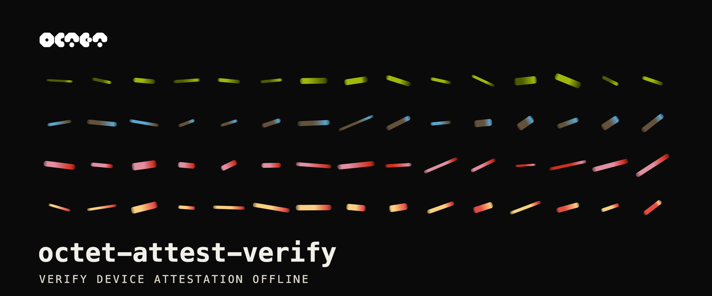

<p align="center">
  <a href="https://octetproof.com">
    
  </a>
</p>

<div align="center">

**Check that an Octet location proof came from a genuine app on genuine hardware: offline, against Apple's and Google's roots.**

[](https://crates.io/crates/octet-attest-verify) [](https://docs.rs/octet-attest-verify) [](LICENSE) [](https://github.com/octetproof/octet-attest-verify)

[](https://octetproof.com) [](https://octetproof.com/docs/v3.0/concepts/device-attestation/) [](https://github.com/octetproof/octet-verify)

</div>

> [!IMPORTANT]
> **Octet proves; you decide.** Octet gives you the tools to define a location
> policy and a signed proof of where a device was. It does not block, allow or
> change anything in your app or on your servers. Your backend verifies the proof
> and decides what happens to the request. If your backend ignores the answer,
> nothing is enforced.

## What it is

An Octet `LocationProof` can carry evidence that it was made by a genuine app
instance on genuine device hardware. This crate checks that evidence:

- **Apple App Attest** (iOS): the attestation object and per-proof assertions,
  to Apple's App Attest root.
- **Android key attestation**: the Keystore certificate chain, to Google's
  hardware-attestation roots, proving the key lives in a TEE or StrongBox.
- **Google Play Integrity** (Android): the pass policy over a decoded integrity
  token.
- **App-to-web bridge**: the device key's signature over a web page's report.

It holds no secret and, for App Attest and key attestation, makes no network
call: the same evidence verifies the same way anywhere.

> [!TIP]
> To check a whole proof (signatures, bindings, region and attestation in one
> run), use [`octet-verify`](https://github.com/octetproof/octet-verify) with
> `--features appattest`. It calls this crate for the attestation layer.

## Quick start

```toml
[dependencies]
octet-attest-verify = { version = "2", features = ["keyattest"] }
```

Verify an App Attest attestation object for your app:

```rust
use octet_attest_verify::appattest::{verify_attestation, AcceptEnvironment, AppId};

let app_id = AppId::from_team_and_bundle("ABCDE12345", "com.example.app");
let key = verify_attestation(&attestation_object, &nonce, &app_id, &key_id, AcceptEnvironment::Production)?;
// key.public_key_sec1 is the attested device key; later assertions verify against it.
```

The crate does not parse proofs: the caller (such as `octet-verify`) extracts the
attestation bytes and passes them in. That keeps the trust-bearing code free of
any wire format.

## How it works

| | App Attest (iOS) | Key attestation (Android) | Play Integrity (Android) |
|---|---|---|---|
| Trust anchor | Apple's App Attest **root CA**, built in | Google's hardware-attestation **roots**, built in and fingerprint-pinned | Google, through **your Play Console project** |
| Offline | **yes**: no network, no secrets | **yes**: no network, no secrets | **no**: decoding is bound to your Cloud project |
| Feature | default | `keyattest` | `playintegrity` |

App Attest and key attestation are the layers you are asked to trust as
auditable anchors: offline, and depending only on published vendor roots. Play
Integrity decoding needs Google, so it sits behind a feature flag for integrators
who wire their own Cloud project.

<details>
<summary><b>App Attest: what is checked</b></summary>

Given the attestation object and assertion a proof carries, the nonce, and the
proof's own commitment and timestamp:

1. the CBOR attestation object is parsed;
2. its certificate chain is validated to the Apple App Attest root;
3. the attested **App ID** must match the one you expect
   (`SHA256("<TeamID>.<BundleID>")`);
4. the assertion signature is verified with the attested key, and its counter
   must have advanced (anti-replay);
5. the per-proof challenge is rebuilt from the proof's fields and must match.

A stateless variant (`verify_attestation_with_client_data_hash`) checks an
attestation on every request with nothing stored between calls.

</details>

<details>
<summary><b>Android key attestation: what is checked (<code>keyattest</code>)</b></summary>

Given the proof's `certificate_chain` and the expected challenge,
`verify_key_attestation`:

1. parses the chain and checks every certificate's validity window;
2. verifies each signature up the chain (RSA or ECDSA, SHA-256/384);
3. anchors the top to an embedded, fingerprint-pinned Google root (the RSA-4096
   root and the ECDSA P-384 root effective 2026-02-01);
4. reads the leaf's KeyDescription and enforces the challenge and a TEE or
   StrongBox security level.

It does **not** check online revocation (Google's status list); see
[spec §3.1](spec/attestation-verification.md).

</details>

<details>
<summary><b>Play Integrity: what is checked (<code>playintegrity</code>)</b></summary>

Turning the opaque token into a verdict is bound to your Play Console project, so
that decode step is yours. Given the **decoded** payload, the crate:

1. `check_device_integrity()`: passes on `MEETS_DEVICE_INTEGRITY` or
   `MEETS_STRONG_INTEGRITY`; basic integrity, an empty verdict or a missing field
   fail closed;
2. `check_binding` / `check_binding_packages`: the token's nonce equals the
   proof's `attestation_nonce`, and its package is one you expect;
3. `check_freshness(now_ms, max_age_ms)`: the token's timestamp is inside the
   window.

`appRecognitionVerdict` and `appLicensingVerdict` are reported but never gate.

</details>

## Cargo features

| Feature | Adds |
|---|---|
| *(default)* | offline Apple App Attest and the app-to-web bridge |
| `keyattest` | offline Android key attestation (adds the crate's only RSA dependency) |
| `playintegrity` | the Play Integrity pass-policy helpers |
| `config` | load the verification config from one TOML file (see [`octet-attest-verify.example.toml`](octet-attest-verify.example.toml)) |

## Documentation

| Document | What it covers |
|---|---|
| [`spec/attestation-verification.md`](spec/attestation-verification.md) | the byte-exact contract, shared with the SDK and any re-implementation |
| [docs.rs](https://docs.rs/octet-attest-verify) | the API |
| [`SECURITY.md`](SECURITY.md) | how to report a vulnerability |
| [`CHANGELOG.md`](CHANGELOG.md) | what changed in each release |

## Security

Report a vulnerability as described in [`SECURITY.md`](SECURITY.md). Please do
not open a public issue for one.

## License

Licensed under the **Apache License 2.0**. See [`LICENSE`](LICENSE) and
[`NOTICE`](NOTICE).
